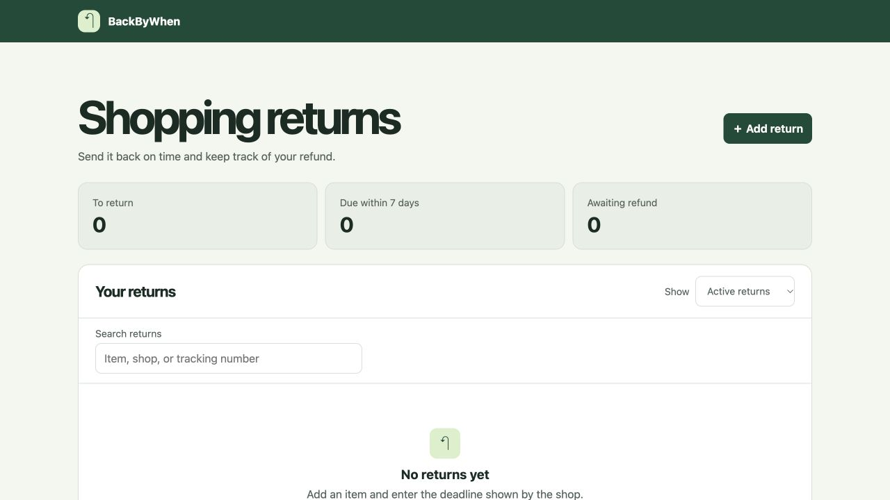

# BackByWhen

A mobile-friendly web app for tracking shopping returns, from the shop’s deadline to your refund.

**[Try BackByWhen](https://chyta2.github.io/backbywhen/)**



## What you can do

- See which returns are due soon or overdue.
- Download a reminder for your calendar.
- Save parcel tracking numbers and flag refunds for follow-up.
- Search by item, shop, or tracking number.

No account required. Your return entries are stored in your browser.

## Use it

1. Select **Add return**. Enter the item and the return deadline shown by the shop. The shop name is optional.
2. Choose when you want a calendar alert. Save the return, select **Add to calendar**, then open the downloaded `.ics` file and confirm the alert in your calendar.
3. Select **Mark sent** after shipping the item and **Mark refunded** after receiving the refund. Use **Show** to revisit completed returns.
4. Add the parcel’s tracking number and an optional refund follow-up date. The tracker highlights follow-ups that are due or overdue. Search by item, shop, or tracking number to find an entry.

The exported event is set for 09:00 local time on the selected reminder day. Your calendar handles the alert and its settings determine whether it appears. Editing, sending, or deleting a return in the tracker leaves any previously imported calendar event in place. Update or remove that event in your calendar as needed.

## Run locally

Serve this folder with a static web server. For example, with Python 3 installed:

```sh
python3 -m http.server 8000
```

Open [http://localhost:8000](http://localhost:8000). The app uses plain HTML, CSS, and JavaScript and has no build step or external dependencies.

## Deploy your own copy

In your repository’s **Settings → Pages**, choose **Deploy from a branch** and select your default branch and **/ (root)**.

## First release plan

- **Capture** a return in one form with a shop-supplied deadline.
- **Prioritize** open returns by deadline and highlight overdue items and those due within seven days.
- **Remind** through a downloadable calendar event with a configurable lead time.
- **Close the loop** with sent and refunded states and a filter for completed returns.
- **Validate with users** by observing whether they can add a return, import the alert into their usual calendar, and record their refund without help.

Data is stored in the current browser under the site’s address. Clearing site data removes the list, and returns are specific to that browser and device.
